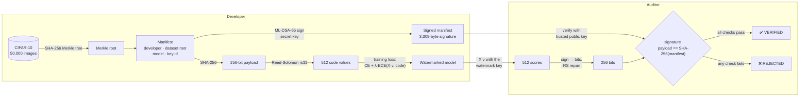
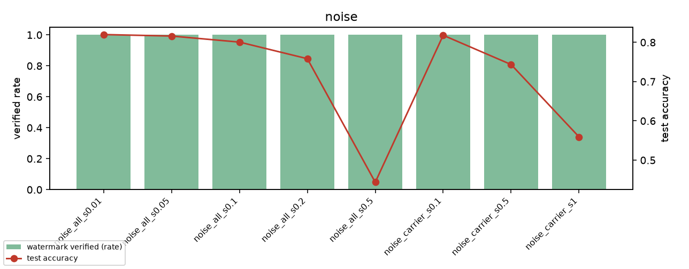
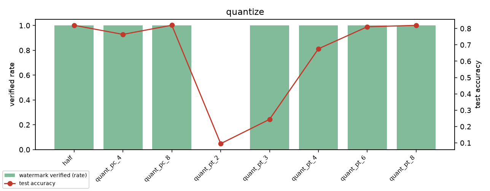
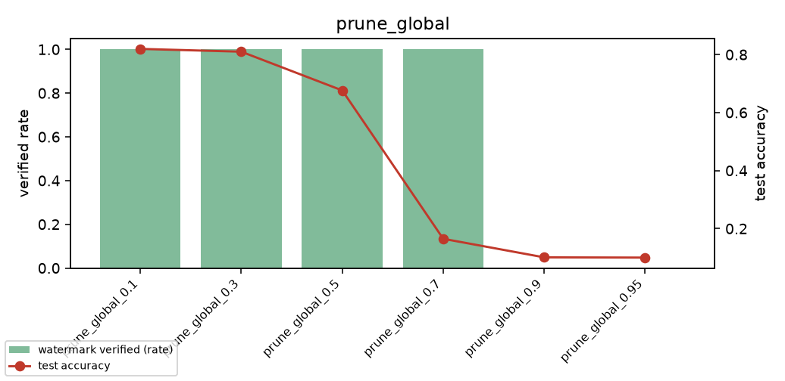
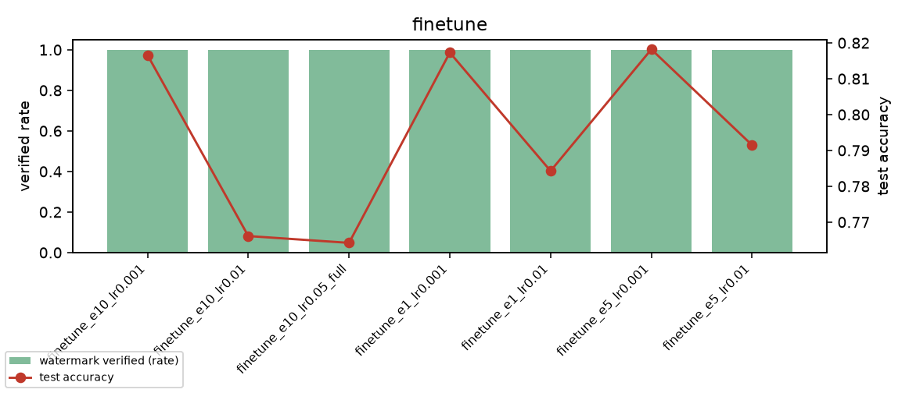
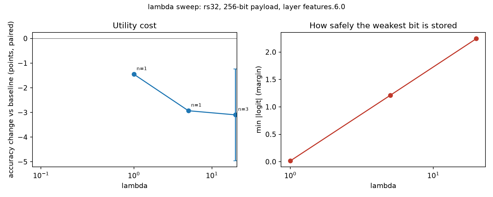
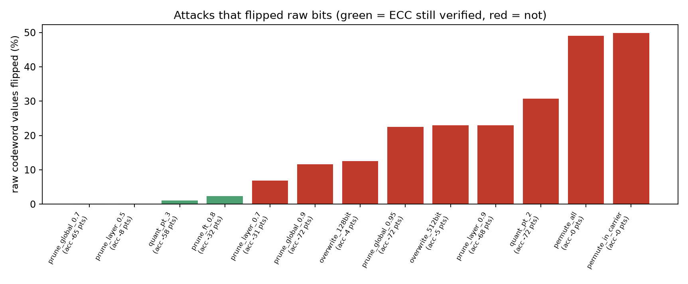

<div align="center">

# Post-Quantum AI Provenance Watermarking

**A tamper-proof, quantum-safe "birth certificate" hidden inside a neural network's weights.**

[-6f42c1)](https://csrc.nist.gov/pubs/fips/204/final)
[](#quick-start)
[](https://pytorch.org)
[](https://github.com/open-quantum-safe/liboqs-python)
[](#tests)
[](#roadmap)

*Sign a model's origin with a post-quantum signature, hide the proof in its weights,<br>and let anyone check it with one command: **VERIFIED** or **REJECTED**.*

[How it works](#how-it-works) · [Results](#results) · [Quick start](#quick-start) · [Dashboard](#pqctl-the-control-centre) · [Limitations](#honest-limitations) · [Roadmap](#roadmap)

</div>

---

## At a glance

| | |
|---|---|
| **Quantum-safe signature** | The model's manifest is signed with **ML-DSA-65** (NIST FIPS 204), which resists Shor's algorithm. RSA and ECDSA do not. |
| **Proof inside the weights** | A **256-bit payload** derived from the signed manifest is embedded *in the weights* during training, so stripping a signature file does not remove the proof. |
| **Dataset commitment** | All **50,000 CIFAR-10 training images** are committed with a single **Merkle root**: change one pixel, label or image order and verification fails. |
| **Error correction** | **Reed-Solomon (rs32)** protects the payload: 256 bits become 512 code values, so damaged bytes can be repaired. |
| **Attacked 216 times** | **43 attack configurations** (noise, pruning, quantization, fine-tuning, rescaling, permutation, overwriting) on 3 models: **177 of 216 copies still verified**. |
| **Zero false accepts** | **0 of 18** unwatermarked baseline models were ever accepted, attacked or not. |
| **One control centre** | `pqctl`: a local web dashboard and terminal tool that runs every phase, plus interactive labs (Watermark X-ray, Attack lab, Tamper lab, Signing lab). |

---

## Why this exists

AI models get copied, fine-tuned, re-uploaded and passed off as someone else's work. Two problems make that easy:

1. **A signature file next to a model can simply be deleted.** Nothing in the weights says who made them.
2. **Today's signatures will not last.** RSA and elliptic-curve signatures can be forged by a large enough quantum computer running Shor's algorithm. A model signed today with ECDSA could be "re-signed" by anyone in the future.

This project fixes both: the **proof lives inside the weights**, and it is bound to a record signed with a **post-quantum** algorithm.

> **Actors.** The **Developer** trains, signs and embeds. The **Model** carries the watermark. The **Auditor** extracts and verifies (white-box access to the weights).

---

## How it works



**Step by step:**

1. **Commit to the dataset.** Every raw training image becomes a Merkle leaf, `SHA-256(0x00 | index | label | pixels)`, and the leaves are hashed up to one root. Domain-separated leaf and node hashes, and the index inside each leaf, mean images cannot be swapped, re-labelled or edited without changing the root.
2. **Write and sign a manifest.** A canonical JSON record (developer id, dataset root, architecture, parameter count, key id) is signed with **ML-DSA-65**.
3. **Derive the payload.** `payload = SHA-256(canonical manifest bytes)`, all 256 bits of it. Edit one character of the manifest and about half the payload bits change.
4. **Embed it.** The carrier vector `v` is one conv layer's weights averaged over output filters (576 numbers). A secret ±1 matrix `X`, expanded with SHAKE-256 from the **watermark key**, turns `v` into 512 scores. Training adds `λ · BCE(sigmoid(X·v), codeword)` to the usual cross-entropy, in the style of Uchida et al.
5. **Verify.** The auditor checks the signature, rebuilds the model at the signed width, checks the parameter count and that the weights are finite, reads the 512 scores, repairs them with Reed-Solomon, and requires **all 256 bits** to equal `SHA-256(signed manifest)`. A decoder saying "ok" is never enough on its own.

> **Why ECC?** The sign of each score is one bit and its size is the confidence. The decoder uses that: the least confident bytes are marked as *erasures*, which cost half as much to repair as errors (soft decoding).

---

## Results

All numbers below are measured, not projected. They come from `runs/`, `results/` and `docs/`, and every one can be regenerated with `python -m pqctl pipeline check-all`.

### Accuracy cost of the watermark

SmallCNN (160,234 parameters) on CIFAR-10, 30 epochs, accuracy differences paired by seed:

| Model | Test accuracy | Change vs baseline |
|---|---:|---:|
| Baseline, no watermark (3 seeds) | **85.07% ± 1.19** | — |
| **rs32, layer `features.6.0`, λ = 20 (chosen design)** | **81.98%** | **−3.10 pts** |
| rs16, layer `features.6.0`, λ = 20 | 82.26% | −2.81 pts |
| rep2, layer `features.6.0`, λ = 20 | 81.52% | −4.20 pts |

Every chosen-design model decodes with **0 bit errors** after correction (minimum margin 2.24).

### Robustness: 43 attacks × 3 models

A removal only counts as a **success** if the verifier stops saying VERIFIED **and** the model is still useful (accuracy within 5 points of the clean model). Destroying a model to kill its mark proves nothing.

| Attack family | Strongest setting that still verified | Outcome |
|---|---|:---:|
| Gaussian noise (all weights) | σ = 0.5 × weight spread (accuracy falls to 44%) | ✅ held |
| Noise aimed at the watermark layer | σ = 1.0 (accuracy 56%) | ✅ held |
| Global magnitude pruning | 70% of weights deleted (model already useless) | ✅ held |
| Quantization, per tensor | **3 bits**, ECC repaired 5.3 bytes on average | ✅ held |
| float16 round trip | exact | ✅ held |
| Fine-tuning | 10 epochs on the **full** dataset, lr 0.05 | ✅ held |
| Prune 50% + fine-tune | 3 epochs | ✅ held |
| Channel rescaling (function-preserving) | ×10 on every layer | ✅ held |
| Shuffle the carrier's **output** channels | all 9 runs | ✅ held |
| Shuffle the carrier's **input** channels | — | ❌ **removed** |
| Overwrite with a second 128-bit watermark | — | ❌ **removed** (−3.7 pts) |

**Totals:** **177 / 216** attacked copies verified · **0 / 18** false accepts on unmarked models · **4** attack types removed the mark while keeping the model useful (input-channel and all-layer permutation, and 128- and 512-bit overwrite). See [`docs/phase6_results.md`](docs/phase6_results.md) for the full table.

<details>
<summary><b>Show the plots</b></summary>

| | |
|:---:|:---:|
|  |  |
| **Noise** | **Quantization** |
|  |  |
| **Global pruning** | **Fine-tuning** |
|  |  |
| **λ trade-off (Phase 7)** | **ECC under attack (Phase 7)** |

</details>

### Why post-quantum costs bytes

| Scheme | Public key | Signature | Quantum-safe |
|---|---:|---:|:---:|
| RSA-2048 | 256 B | 256 B | ❌ |
| ECDSA P-256 | 64 B | 64 B | ❌ |
| Ed25519 | 32 B | 64 B | ❌ |
| **ML-DSA-65 (this project)** | **1,952 B** | **3,309 B** | ✅ |

That size is why the design hides only a 256-bit *fingerprint* of the manifest in the weights and ships the full signature next to the model.

---

## Quick start

### 1. Install

```bash
git clone https://github.com/shield44-project/post-quantum-cryptography.git
cd post-quantum-cryptography
python -m venv venv && source venv/bin/activate        # Windows: venv\Scripts\activate

pip install torch torchvision --index-url https://download.pytorch.org/whl/cpu
pip install -r requirements.txt
```

**liboqs-python** (ML-DSA) is built from source:

```bash
sudo apt install -y git cmake ninja-build build-essential libssl-dev   # Fedora: dnf install the same tools
git clone --depth=1 https://github.com/open-quantum-safe/liboqs-python
pip install ./liboqs-python
python tests/test_mldsa.py                                            # prints: correct message: True
```

> On native Windows, see *Setup: liboqs on native Windows* in [`docs/phase_commands.md`](docs/phase_commands.md).
> `keys/` is git-ignored. To verify the shipped models, get `keys/public_key.bin` and `keys/watermark_key.bin` from the team.

### 2. Verify a model

```console
$ python -m verify.verify_model --model runs/wm_v1/lam20_n256_rs32/seed0/model.pt
watermark settings (final.json): ecc rs32 | n_bits 256 | layer features.6.0.weight | mode mean
PASS  load release files
PASS  key id matches manifest  (manifest=bae58d20d2964be6ef068a9ff17772af key=bae58d20d2964be6ef068a9ff17772af)
PASS  algorithm is ML-DSA-65
PASS  signature valid
PASS  payload.hex matches manifest
PASS  architecture is SmallCNN  (manifest says 'SmallCNN')
PASS  model loads at signed width 32
PASS  parameter count matches manifest  (model 160234, manifest 160234)
PASS  weights are finite numbers
PASS  watermark read (ecc rs32, 512 values)  (min margin 2.25, corrected 0, erasures 0)
PASS  extracted payload == SHA-256(signed manifest)  (256 bits match)
VERIFIED
```

Try it on an unmarked model and it is rejected:

```bash
python -m verify.verify_model --model runs/baseline/seed0/model.pt      # REJECTED
```

For scripts and CI, `--json` prints one machine-readable object, and the exit code is `0` only for VERIFIED:

```bash
python -m verify.verify_model --json --model path/to/model.pt | jq .verdict
```

### 3. Re-prove everything

```bash
python -m pqctl pipeline check-all     # ~1-5 min: every test, signature, tamper demo, watermark, negative case
```

---

## pqctl: the control centre

A **standard-library-only** dashboard and CLI that runs every phase of the project, streams live logs and shows the results.

```bash
python -m pqctl serve        # opens http://127.0.0.1:8765
python -m pqctl              # interactive terminal menu
```

| Page | What you get |
|---|---|
| **Home** | Headline numbers, results charts, phase board, one-click pipelines |
| **Watermark X-ray** | The 576 carrier numbers as a heatmap, a histogram of the 512 scores, every code value before repair, the Reed-Solomon repair, and the 256 payload bits against the signed record. Read with our key, Mallory's key or a random key |
| **Attack lab** | Play the thief: pick any attack and strength, damage a copy, and watch which bits flip and whether it still verifies, next to what Phase 6 measured |
| **Tamper lab** | Play the forger: edit the developer, width, dataset root, signature or key, and see the fingerprint change live in the browser before verifying |
| **Signing lab** | ML-DSA-65 on any text with a throwaway key pair, with timings and size comparisons |
| **Hash and Merkle** | A live SHA-256 avalanche demo and an 8-leaf Merkle tree you can edit |
| **Release and keys** | The signed manifest, the exact signed bytes, key ids, fingerprints and the frozen model hashes |
| **Test model** | 11 live tests with expected results, including the two known weaknesses |
| **Phases 0-7** | Every step with its options, the exact command, a **Run** button and a **Colab cell** button for GPU steps |

**Built safe:** listens on `127.0.0.1` only · per-session token on every POST · Host and Origin checks · files under `keys/` are never served · only steps defined in `pqctl/tasks.py` can run (no free-form commands) · overwriting keys or the release requires typing `OVERWRITE`.

```bash
python -m pqctl run lab.xray --set model=runs/baseline/seed0/model.pt
python -m pqctl run lab.attack --set attack=prune_global --set strength=0.5
python -m pqctl run lab.tamper --set developer_id=Mallory
python -m pqctl colab p4.train                     # a ready-to-paste Colab cell for a T4 GPU
```

Full guide: [`docs/PQCTL.md`](docs/PQCTL.md).

---

## Negative cases: what must be rejected

`python -m experiments.phase5_negative_cases` runs 8 cases per seed, and each must fail **for the right reason**:

| Case | Expected | Stops at |
|---|:---:|---|
| Our model + our files | ✅ VERIFIED | — |
| Wrong public key | ❌ REJECTED | key id check |
| Wrong watermark key | ❌ REJECTED | watermark / payload |
| Tampered manifest (`developer_id`) | ❌ REJECTED | signature |
| Unmarked baseline model | ❌ REJECTED | watermark / payload |
| Mallory's model + our files | ❌ REJECTED | watermark / payload |
| Our model + Mallory's files | ❌ REJECTED | watermark / payload |
| Mallory's model + Mallory's files | ✅ VERIFIED | — |

**Hardening built in:**

- **Full payload required (fix H1):** a forger cannot ask the verifier to check only 8 bits and retry keys until an unrelated model passes.
- **No code execution:** checkpoints are loaded as plain tensors only, so a malicious pickled `.pt` file is rejected, never run.
- **NaN/inf weights are rejected** explicitly.

---

## Honest limitations

This project is pitched to mentors and faculty, so its claims must be defensible. Here is what it does **not** do:

- **Channel permutation removes the watermark.** Shuffling the channels that feed the carrier layer keeps the model's answers identical but scrambles the carrier vector. This is the main open weakness (planned: Phase 6b).
- **Overwriting works, at a cost.** Fine-tuning a second watermark into the same layer removed ours with a 3.7-point accuracy drop.
- **Accuracy cost.** About 3 points with the chosen design (85.1% → 82.0%).
- **White-box only.** The auditor needs the weights, not just API access.
- **Not a data-quality proof.** The Merkle root proves *which* data was committed, not that it was clean, and not that the weights were actually trained on it.
- **Distillation is out of scope.** Training a fresh model on our model's outputs is not defended against.

Full threat model: [`docs/threat_model.md`](docs/threat_model.md).

---

## Repository layout

```text
crypto/          Merkle tree, canonical manifest, ML-DSA-65 wrappers
embedding/       projection watermark, watermark keys (SHAKE-256), ECC (none / rep / Reed-Solomon), extraction
training/        SmallCNN, baseline and watermarked training (CE + λ·BCE)
verify/          verify_release (signature) and verify_model (the auditor's one command)
attacks/         Phase 6 suite: weight attacks, training attacks, registry, evaluation, summary
experiments/     one script per phase "done when" check, Phase 7 collection and plots
pqctl/           the control centre: tasks, runner, web server, lab actions, static dashboard
tests/           63 unit and integration tests (no project keys needed)
release/         the signed manifest, payload.hex and public key
mallory/         a second developer, for the negative cases
runs/  results/  trained models, attacked copies, tables and plots
docs/            threat model, measured results, every command used, pqctl guide
```

---

## Roadmap

| Phase | Title | Status |
|:---:|---|:---:|
| 0 | Scope, threat model, tooling | ✅ |
| 1 | Baseline CNN (3 seeds) | ✅ |
| 2 | Merkle root, manifest, ML-DSA signature, tamper demo | ✅ |
| 3 | First watermark (32 bits, no ECC) | ✅ |
| 4 | Full 256-bit payload with Reed-Solomon, noise test | ✅ |
| 5 | One-command verifier, Mallory, negative cases | ✅ |
| 6 | 43-attack suite and results | ✅ |
| 6b | Fix the weak spots: permutation defence, stronger fine-tuning | planned |
| 7 | Evaluation: λ, ECC and payload sweeps, more seeds, ResNet-18 | in progress (P7.1 done) |
| 8 | Write-up, 3-minute live demo, mentor Q&A | planned |

---

## Tests

```bash
pytest                    # 63 tests: Merkle, manifest, ML-DSA, projection, ECC, verifier, attacks, pqctl
```

The tests are self-contained: they make temporary keys, releases and small watermarked models, and never touch `keys/`, `release/` or `runs/`.

---

## Team

Built by engineering students: **shield44 (Thejas K S)**, **Krishnadasa Raja**, **PKgamerzop** and **mahithreddy-bit**. Training ran on Google Colab (Tesla T4). Local work ran on Fedora, WSL2 Ubuntu and native Windows 11.

## References

- NIST **FIPS 204**: *Module-Lattice-Based Digital Signature Standard (ML-DSA)*, 2024.
- Y. Uchida, Y. Nagai, S. Sakazawa, S. Satoh: *Embedding Watermarks into Deep Neural Networks*, ICMR 2017.
- R. Merkle: *A Digital Signature Based on a Conventional Encryption Function*, CRYPTO 1987.
- I. Reed, G. Solomon: *Polynomial Codes over Certain Finite Fields*, 1960.
- [Open Quantum Safe / liboqs](https://openquantumsafe.org) and [`reedsolo`](https://pypi.org/project/reedsolo/).

<div align="center">

---

**Signed today. Still trustworthy after quantum computers arrive.**

</div>
